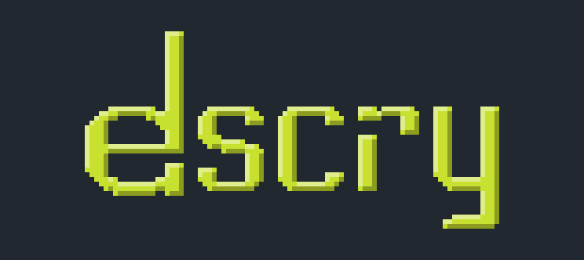

**a tracker and synthesizer for the new nintendo 3ds.**

write beats, build synth voices and turn recorded sounds into instruments.
arrange phrases into songs, launch chains live and reshape the mix with the
touchscreen. everything runs on the console.

- **eight tracks** with song → chain → phrase sequencing, variable phrase lengths and three fx columns per step.
- **five engines**: wavsynth with user wavetables, four-operator fm, sampler, drumkit and an analog-style dsn voice.
- **movement and variation**: modulation tables, 23 fx commands, groove, swing, conditions and phrase generators.
- **sampling**: microphone recording, master resampling, wav import, slicing, editing and procedural drum sounds.
- **live performance**: touch keyboard, pads, mixer, assignable xy control and quantized chain launches.
- **mixing and export**: per-track processing, shared delay/reverb, stereo wav export and synchronized dry stems.

[download](https://github.com/patausx/descry/releases/latest) · [user guide & installation](docs/GUIDE.md) · [build from source](BUILDING.md) · [changelog](CHANGELOG.md)

## status

`v1.0.7` · homebrew.

**requires a new 3ds, new 3ds xl or new 2ds xl.**
original 3ds/2ds is not supported.

## license

[gpl-3.0](LICENSE). independent homebrew, not an official nintendo product.
